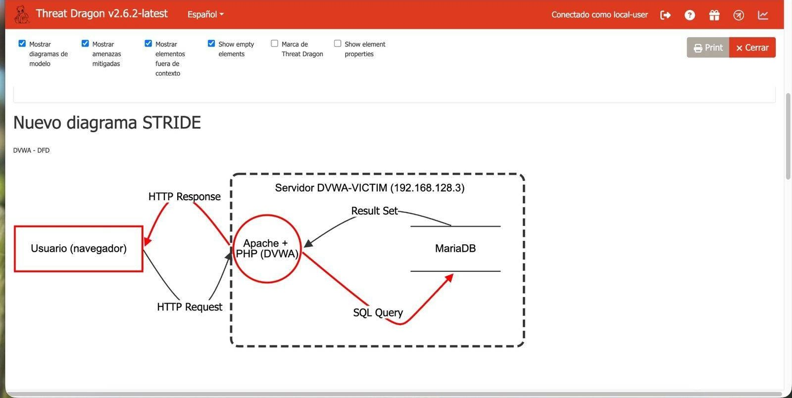
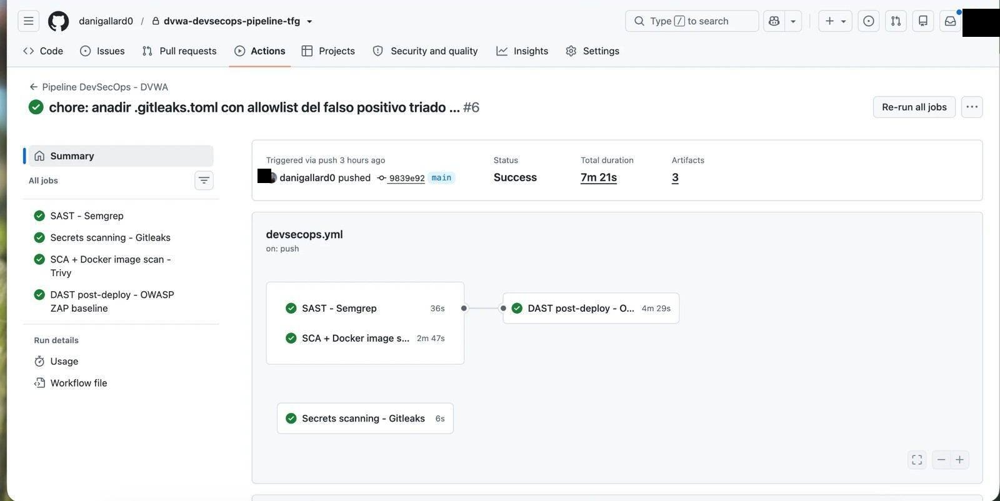

# Desarrollo Seguro — SAST, DAST, modelado de amenazas y pipeline DevSecOps real

Segundo bloque del TFG: coger la misma aplicación explotada a mano en el [Bloque Ofensivo](../bloque-ofensivo/) (DVWA) y analizarla con las herramientas y el proceso que debería haber existido antes de desplegarla — SAST, DAST, modelado de amenazas y un pipeline CI/CD real con 4 etapas de seguridad, no solo diseñado sobre el papel.

---

## Análisis estático (SAST) — Semgrep

86 hallazgos sobre 231 ficheros, agrupados por categoría OWASP Top 10: inyección SQL, inyección de comandos, path traversal, criptografía insegura (MD5 sin sal) y uso de `eval()` sobre entrada controlable por URL. Incluye el triaje de un falso positivo real (un `intval()` que Semgrep no reconoce como saneamiento) y la distinción entre una regla que salta por una comparación MD5 dentro de una consulta SQL — mala práctica, pero no explotable por el ataque clásico que la regla asume.

---

## Análisis dinámico (DAST) — OWASP ZAP

Dos pasadas, vía API REST (no interfaz gráfica, para que fuera reutilizable en el pipeline):

| Escaneo | High | Medium | Low |
|---|---|---|---|
| Sin autenticar | 0 | 5 | 4 |
| Autenticado (sesión inyectada vía cookie `PHPSESSID`) | **2** | 11 | 9 |

El hallazgo más interesante: una inyección SQL **High** en `setup.php` — el propio script de instalación de la aplicación, no el módulo de SQLi "oficial" que ya se había explotado a mano. Ejemplo real de cómo el escaneo automatizado cubre superficie de ataque que la revisión manual, centrada en lo obvio, puede pasar por alto.

---

## CVSS manual con la calculadora oficial de NIST

Dos vectores calculados a mano sobre hallazgos reales de SAST/DAST — 9.8 (Crítico) para la SQLi de `setup.php` (sin ninguna credencial requerida), 8.8 (Alto) para una inyección de comandos en el módulo API (requiere credencial de bajo privilegio, el matiz exacto que baja la puntuación).

---

## Modelado de amenazas (DFD + STRIDE) — OWASP Threat Dragon

Diagrama de flujo de datos completo con su único límite de confianza (el servidor de la aplicación), y las 6 categorías STRIDE aplicadas sobre los elementos reales del diagrama — cada amenaza enlazada a una evidencia concreta ya encontrada en SAST, DAST o en la explotación manual del Bloque Ofensivo, no a un ejemplo genérico de manual. Incluye un caso de abuso (ataque deliberado) y un caso de mal uso (daño accidental por un usuario legítimo).

---

## Pipeline DevSecOps — GitHub Actions, 4 etapas, ejecutado de verdad

En vez de quedarse en el diseño del YAML, el pipeline se montó y se ejecutó contra un repositorio real:

| Etapa | Herramienta | Resultado real |
|---|---|---|
| SAST | Semgrep | 44 hallazgos, coherente con el análisis manual |
| Secrets scanning | Gitleaks | 1 falso positivo triado (token CSRF de ejemplo) y documentado con regla de exclusión explícita |
| SCA + imagen Docker | Trivy | 0 vulnerabilidades en dependencias del proyecto; 2124 CVEs heredados de la imagen base del sistema operativo |
| DAST post-despliegue | OWASP ZAP (baseline) | 0 fallos nuevos críticos sobre la app ya desplegada con `docker compose` |

El pipeline falló tres veces de verdad antes de quedar en verde (versión de action inexistente, permisos insuficientes para crear un Issue automático, un bug conocido de la action de ZAP) — cada incidencia quedó diagnosticada y resuelta, no escondida.

---

## Correcciones reales sobre el código

Tres vulnerabilidades corregidas de verdad sobre el código fuente (no solo documentadas): **SQL Injection** (sentencia preparada + validación de tipo), **Command Injection** (validación de IP + `escapeshellarg()`) y **CSRF** (token obligatorio + verificación de contraseña actual). Cada corrección se verificó repitiendo el ataque original contra el código corregido (ahora rechazado) y comprobando que el uso legítimo seguía funcionando. Al subir los 3 commits, el pipeline volvió a ejecutarse solo: Semgrep bajó de 44 a 38 hallazgos — exactamente los patrones corregidos, ni uno más ni uno menos.

---

## Lo que me llevo

La parte más valiosa de este bloque no fue encontrar vulnerabilidades — eso ya lo sabía hacer tras el Bloque Ofensivo — sino ver cómo tres técnicas distintas (estático, dinámico, modelado de amenazas) señalan el mismo problema desde ángulos diferentes, y lo poco que vale automatizar un escaneo si nadie revisa después por qué salta una alerta o por qué no salta otra.

---

*Aplicación objetivo (DVWA) desplegada en un laboratorio propio y aislado, como continuación directa del [Bloque Ofensivo](../bloque-ofensivo/) de este mismo proyecto.*
