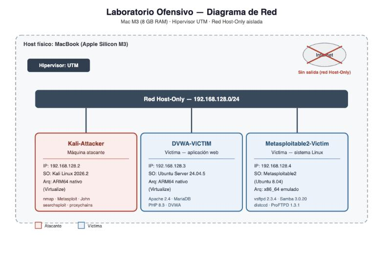

# Laboratorio de Ciberseguridad — Pentest de principio a fin

Laboratorio de ciberseguridad construido y operado de forma íntegra por mí, como parte de mi TFG en Ciberseguridad. Entorno completamente aislado (sin salida a Internet salvo en las fases que explícitamente lo requieren), con evidencia y metodología documentadas en cada paso.

Este documento cubre el **Bloque Ofensivo**: reconocimiento, análisis de vulnerabilidades, explotación, post-explotación e informe de pentest profesional. Es el primero de los 5 bloques del proyecto — el resto ([Desarrollo Seguro](../bloque-devseguro/), [Protección](../bloque-proteccion/), [SOC/IR](../bloque-soc-ir/), [Gobierno](../bloque-gobierno/)) está enlazado desde el [índice general](../README.md).

---

## Arquitectura del laboratorio

| Máquina | Rol | Sistema | Notas |
|---|---|---|---|
| Kali Linux | Atacante | Kali 2026.2, ARM64 nativo | nmap, Metasploit, OpenVAS, John the Ripper, proxychains |
| Metasploitable2 | Víctima — sistema | Ubuntu 8.04, x86_64 emulado | Servicios de red deliberadamente desactualizados |
| DVWA | Víctima — aplicación web | Ubuntu Server 24.04 + Apache/MariaDB/PHP | Sistema base actualizado, vulnerabilidades a nivel de app |

Hipervisor: UTM sobre Apple Silicon. Red interna Host-Only, sin conectividad externa salvo en la fase de OSINT (contra un dominio público de práctica, nunca contra las víctimas del laboratorio).

---

## Metodología

Seguido conforme a **PTES** (Penetration Testing Execution Standard), con apoyo de **OSSTMM** para la fase de recogida de información:

`Reconocimiento` → `Análisis de vulnerabilidades` → `Explotación` → `Post-explotación` → `Informe`

---

## Reconocimiento

9 técnicas distintas combinadas, activas y pasivas:

| Técnica | Herramienta |
|---|---|
| Escaneo de puertos/servicios | Nmap |
| WHOIS | `whois` |
| Reconocimiento DNS pasivo | DNSdumpster |
| Recolección de emails/subdominios | TheHarvester |
| OSINT automatizado | SpiderFoot |
| Huella en redes sociales | Sherlock |
| Script de reconocimiento propio | Python (fuerza bruta de subdominios + robots.txt) |
| Análisis TLS | sslscan |

---

## Análisis de vulnerabilidades

Escaneo automatizado con **OpenVAS/Greenbone** (self-hosted) combinado con búsqueda manual en Exploit-DB:

- **34 CVEs** identificados sobre 2 hosts
- Severidad desde **10.0 (Crítico)** hasta **2.1 (Bajo)**
- Análisis CVSS v3.1 manual sobre los hallazgos más relevantes, incluyendo un caso donde el escáner automático puntuaba una vulnerabilidad como Media (6.0) mientras que la explotación real demostraba un impacto Crítico (9.8) — verificación manual frente a confianza ciega en la herramienta.

---

## Explotación — 4 vectores de acceso, ninguno con credenciales válidas

| # | Vector | Objetivo | Resultado | CVE |
|---|---|---|---|---|
| 1 | Backdoor en servicio FTP | Sistema Linux | Shell de root | CVE-2011-2523 |
| 2 | RCE en servicio de compartición de ficheros | Sistema Linux | Sesión de root vía Metasploit | CVE-2007-2447 |
| 3 | Inyección SQL | Aplicación web | Volcado y cracking de credenciales | — |
| 4 | Command Injection | Aplicación web | Shell reversa interactiva | — |

---

## Post-explotación

Ciclo completo tras el acceso inicial:

- **Persistencia** — tarea programada que sobrevive a un reinicio completo del sistema
- **Movimiento lateral** — pivoting hacia el segundo host mediante proxy SOCKS sobre una sesión Meterpreter
- **Exfiltración** — extracción de credenciales reales desde la configuración de la aplicación
- **Covering tracks** — intento de limpieza de logs, bloqueado por una correcta separación de privilegios del sistema operativo (el único control que resistió de verdad durante todo el ejercicio)

---

## Informe de pentest

Documento completo con resumen ejecutivo orientado a dirección, metodología, hallazgos detallados (severidad, descripción, remediación) y tabla de riesgos priorizada — disponible en [`informe-pentest/`](./informe-pentest/).

---

## Lo que me llevo

Ninguna de las vulnerabilidades explotadas es nueva — la más reciente lleva documentada más de una década. Lo que realmente pone a prueba es todo lo que no sale en un writeup limpio: una shell que no se comporta como esperas, una máquina que se cae justo cuando más la necesitas, tener que parar y entender por qué antes de seguir. Ese es el tipo de fricción con la que de verdad se topa cualquiera que haga esto en serio.

---

*Laboratorio propio, aislado y sin conexión a redes de producción ni de terceros. Todas las pruebas se realizaron exclusivamente sobre sistemas de mi propiedad.*
