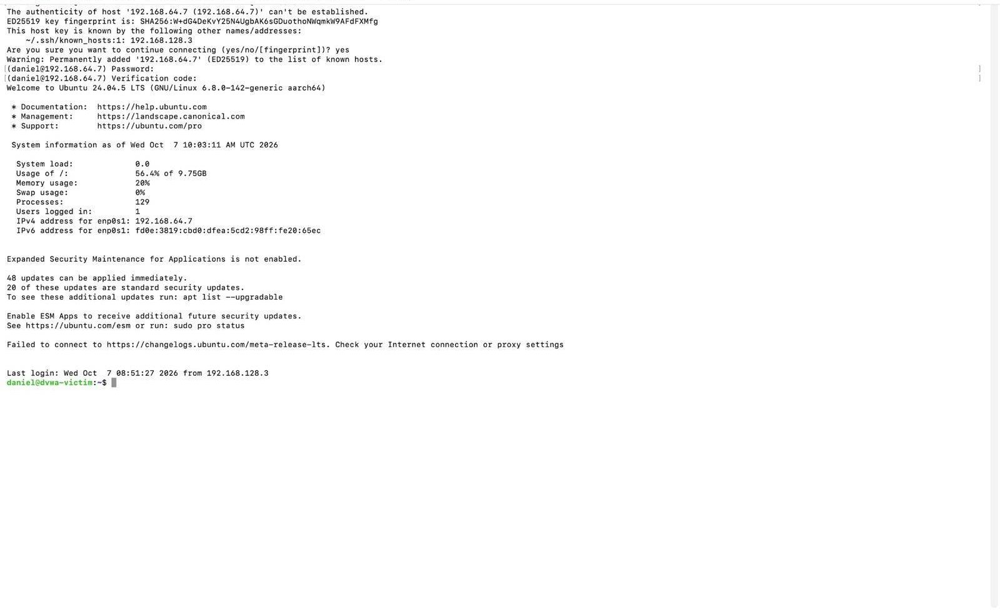
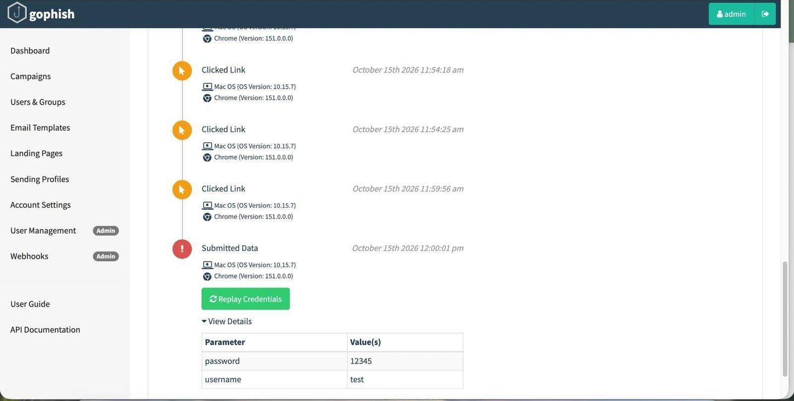

# Protección frente a Ciberamenazas — IAM, hardening, gestión de vulnerabilidades y phishing real

Tercer bloque: coger el servidor web ya explotado en los dos bloques anteriores y aplicarle, de verdad, los controles que deberían haber estado ahí desde el principio — control de identidades, hardening del sistema, un proceso formal de gestión de vulnerabilidades, y una campaña de phishing real con Gophish para cerrar el ciclo completo de "cómo entra un atacante" desde el otro extremo: el factor humano.

---

## Gestión de Identidades y Control de Acceso

- **Política de contraseñas:** longitud mínima 12, complejidad obligatoria, rotación cada 90 días — y un bug real encontrado y cerrado por el camino: PAM solo *avisaba* de una contraseña débil al cambiarla como root, sin bloquearla, hasta añadir `enforce_for_root`.
- **MFA real por TOTP** en el acceso SSH, verificado con un código correcto (entra) y uno incorrecto (`Permission denied`).
- **Mínimo privilegio:** un segundo usuario sin acceso `sudo` general, con permisos explícitos para solo 2 comandos concretos — verificado que puede ejecutar esos dos y ninguno más.

---

## Hardening y firewall deny-by-default

| | Antes | Después |
|---|---|---|
| Puertos permitidos (22, 80) | `open` | `open` (sin cambios) |
| Resto de puertos (998 de 1000) | `closed` | **`filtered`** |

`fail2ban` baneando una IP real tras 3 intentos SSH fallidos, y un firewall `ufw` con política deny-by-default verificada con Nmap antes/después. Por el camino, una incidencia real: tras activar el firewall, el login con MFA empezó a fallar — no era el firewall, era el reloj del sistema desincronizado (sin NTP, VM aislada) rompiendo la ventana de validez del código TOTP. Diagnosticado y corregido ajustando la hora manualmente.

---

## Gestión de Vulnerabilidades — proceso formal, no solo un escaneo

Inventario → escaneo (OpenVAS + ZAP) → priorización por CVSS → decisión de remediación explícita por cada hallazgo, incluyendo los que se dejan **sin corregir a propósito** (con su justificación) y los que quedan como riesgo pendiente real:

| Hallazgo | Decisión |
|---|---|
| `.git/` expuesto por error de despliegue | Corregido y verificado |
| Directory Browsing | Corregido y verificado |
| SQLi en el script de instalación de la app | Pendiente (recomendación: eliminar el script tras la instalación) |
| Ausencia de TLS | Riesgo aceptado (limitación del laboratorio, documentada) |

---

## Campaña de phishing simulada — Gophish, de extremo a extremo

Campaña real contra un único objetivo consciente del ejercicio, con el flujo técnico completo funcionando de verdad: envío por SMTP real, seguimiento de apertura, seguimiento de clic con huella de navegador, y una landing page falsa capturando credenciales.

Una incidencia real durante la construcción de la landing page merece mención aparte: el contador de "credenciales capturadas" se quedaba en 0 pese a que los datos sí viajaban en la petición. La causa, descubierta revisando el log de la propia herramienta: Gophish solo registra el envío de datos en peticiones `POST`, no en `GET`, aunque el parámetro de seguimiento vaya correctamente incluido. Cambiar el método del formulario resolvió el problema a la primera.

Resultado: apertura, clic y credenciales capturadas confirmados de principio a fin con una herramienta real de simulación de phishing, no un mockup.

---

## Lo que me llevo

Los controles técnicos de este bloque (MFA, firewall, hardening) son relativamente mecánicos de aplicar una vez que sabes qué falta — lo que de verdad cuesta es la gestión de vulnerabilidades: decidir, con criterio y no por defecto, qué se corrige ya, qué se acepta como riesgo conocido, y qué se deja pendiente con una fecha y una razón. Ahí es donde se nota la diferencia entre aplicar una checklist y gestionar seguridad de verdad.

---

*Todos los controles se aplicaron y verificaron sobre sistemas propios del laboratorio. La campaña de phishing se dirigió únicamente contra una cuenta de correo propia, nunca contra terceros.*
