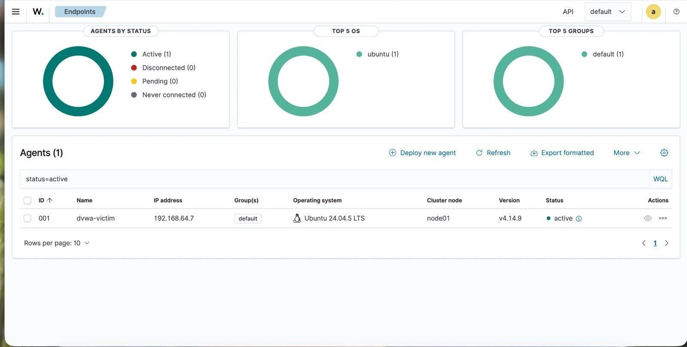
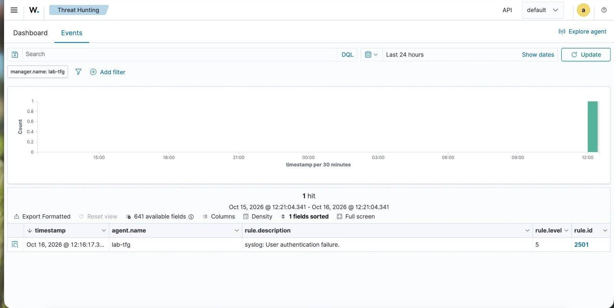
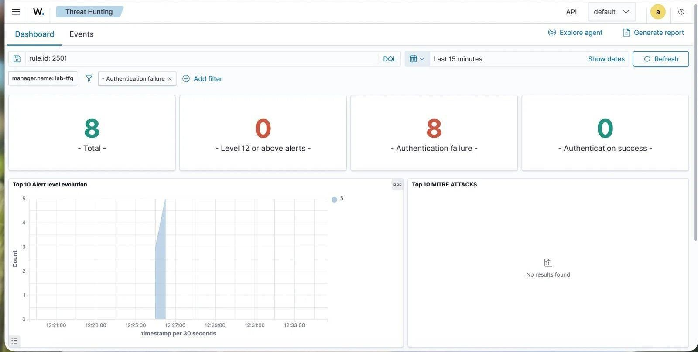
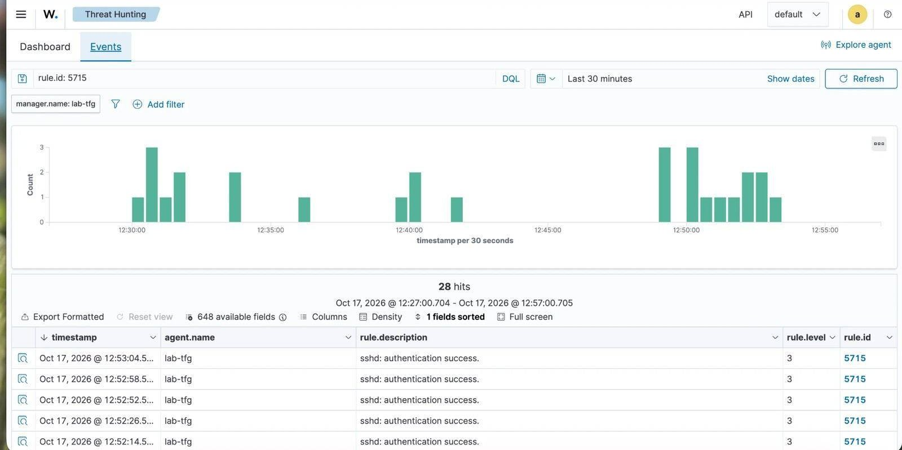
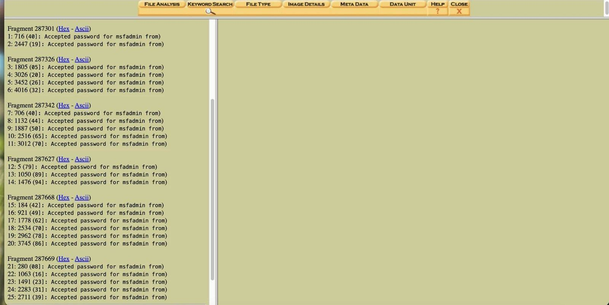
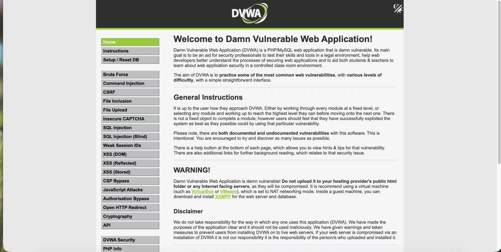

# SOC / Respuesta a Incidentes — SIEM real, caza de amenazas, simulacro e informática forense

El bloque más largo del TFG, y el único que no vive entero en local: el Mac no tiene RAM de sobra para encender a la vez atacante, víctimas y un SIEM completo, así que **Wazuh se despliega en una instancia gratuita de Oracle Cloud** y las máquinas del laboratorio le envían sus logs desde casa. Cubre, de principio a fin, el ciclo completo de un SOC: desplegar el SIEM, detectar con un caso de uso real, cazar un patrón con Threat Hunting, escribir un playbook operativo, ejecutar un simulacro de incidente real (con exfiltración incluida), hacer una adquisición forense del disco "comprometido", y probar — de verdad, no sobre el papel — un Plan de Continuidad de Negocio.

---

## SIEM desacoplado en la nube — Wazuh en Oracle Cloud (ARM64)

Primer intento con el `docker-compose` oficial de Wazuh: fallido, porque las imágenes publicadas son solo `amd64` y la instancia Ampere de Oracle es ARM64 — el manager no sobrevivía ni al arranque bajo emulación QEMU. Solución real: instalación nativa vía los paquetes `.deb` arm64 del propio repositorio de Wazuh (el método que su documentación recomienda para producción de todos modos). Conectar la máquina más antigua del laboratorio, Metasploitable2 (2008, sin agente posible), dejó una cadena de cuatro incidencias reales en capas distintas — algoritmos SSH legacy, una regla de red en la VCN de Oracle, un firewall que rechazaba el origen por un matiz de NAT, y validación con un fallo de autenticación real provocado a propósito — resueltas una por una hasta confirmar la cadena completa de extremo a extremo.

---

## Caso de uso SOC — UC-SOC-001

Caso de uso documentado con su ficha completa (táctica MITRE, fuente de log, condición de disparo, falsos positivos esperados, acciones de respuesta): detección de un fallo de autenticación SSH en Metasploitable2, el host con menos controles nativos del laboratorio por ser demasiado antiguo para llevar agente. Un matiz real que queda documentado: al llegar por syslog sin agente registrado, Wazuh atribuye el evento al propio manager, no al host real — la identificación del origen depende del contenido del mensaje, no de los metadatos.

---

## Threat Hunting — de la hipótesis al patrón confirmado con datos reales

Un evento aislado de fallo de autenticación no distingue un ataque de un simple despiste tecleando la contraseña. Para diferenciarlos, se simuló un ataque de fuerza bruta real (8 intentos con contraseñas distintas en menos de 30 segundos) y se cazó el patrón con una query manual sobre el SIEM: 8 de 8 eventos en una ventana de 23 segundos, hipótesis confirmada con datos reales. Limitación honesta documentada en el propio análisis: el ruleset por defecto no escala este patrón a una alerta de severidad alta sobre una fuente sin agente — detectarlo hoy exige la query manual, no una alerta automática.

---

## Playbook de detección y respuesta — [`PB-SOC-001`](playbook-deteccion/Playbook_Deteccion_FuerzaBruta_SSH.md)

A partir del caso de uso y del patrón cazado, un playbook operativo completo: diagrama de flujo de decisión, criterios explícitos de severidad y escalado, procedimiento de triage → contención → erradicación → recuperación → comunicación → lecciones aprendidas, condiciones de cierre del incidente, y una plantilla de ticket rellenada con el incidente real detectado en el Threat Hunting, no con un ejemplo inventado.

---

## Simulacro de incidente real — acceso SSH no autorizado con exfiltración

Se eligió el escenario de acceso no autorizado SSH porque cierra el hilo narrativo ya abierto en los dos apartados anteriores: la fuerza bruta cazada antes deja de ser una prueba aislada y se convierte en un ataque que llega a su objetivo — la credencial de fábrica de Metasploitable2 cae, el atacante entra y exfiltra un fichero (`/etc/passwd` vía `scp`), con cadena de custodia documentada (hash SHA-256 del fichero exfiltrado).

**Hallazgo real descubierto durante el propio simulacro, no anticipado:** Wazuh detecta en tiempo real los intentos fallidos previos, pero el login exitoso posterior **no genera ninguna alerta visible**, pese a que el mensaje llega bien al manager y el decoder lo clasifica correctamente en pruebas aisladas. La identificación del acceso logrado tuvo que completarse con revisión manual del `auth.log` del host — exactamente la vía que el propio enunciado del ejercicio contempla como válida junto a la alerta SIEM, y una limitación de visibilidad real que queda documentada como mejora pendiente, no escondida.

Recuperación completa (contención → rotación de credencial → verificación) en poco más de 10 minutos desde el acceso logrado hasta el servicio restablecido y verificado.

---

## Adquisición forense básica — con Autopsy

Imagen completa del disco de la máquina "comprometida" (`dd` sobre SSH, sin `nc` intermedio tras un primer intento que truncaba la transferencia) y análisis con Autopsy. Dos hallazgos forenses reales, no anticipados:

- **Verificación de integridad sobre un sistema vivo:** el hash de la imagen adquirida y dos cálculos posteriores del hash de `/dev/sda` en el propio host dieron **tres resultados distintos** — no es un error de procedimiento, es la naturaleza de adquirir en caliente un disco que sigue cambiando entre cada lectura. La práctica correcta es calcular el hash *durante* la propia adquisición, no después por separado.
- **Autopsy 2.24 no interpreta volúmenes LVM nativamente** — hubo que resolver el volumen con herramientas estándar de Linux (`losetup`, `vgscan`/`vgchange`) y generar una segunda imagen ya resuelta antes de poder navegar el sistema de ficheros real.

La búsqueda por palabra clave sobre `auth.log` confirma, de forma independiente al SIEM, la secuencia completa del incidente — incluido el login exitoso que el SIEM no llegó a alertar.

---

## Plan de Continuidad de Negocio — probado de verdad, no solo documentado

BIA con los activos reales del laboratorio, RTO/RPO justificados para los dos servicios críticos (DVWA y el propio SIEM), y una prueba de recuperación real: copia de seguridad real de aplicación y base de datos, desastre provocado de verdad (`DROP DATABASE` + borrado del directorio completo), caída confirmada con `curl`, y restauración verificada con login real y la aplicación completa cargada.

**Tiempo real de recuperación: 1 minuto 53 segundos**, frente a un RTO definido de 15 minutos — documentado también el motivo honesto de por qué es tan rápido (laboratorio de un solo operador, sin pasos de aprobación ni coordinación entre personas) y por qué eso no invalida la prueba ni el RTO fijado para un entorno con más de una persona implicada.

---

## Lo que me llevo

Este bloque es el que más veces me obligó a aceptar que algo "no funciona todavía" en vez de forzar que pareciera que sí: la alerta que no salta para el login exitoso, los tres hashes distintos del mismo disco, Autopsy sin saber leer LVM. Ninguno de esos tres hallazgos estaba planeado — aparecieron haciendo el trabajo, y documentarlos tal cual, con su causa real, enseña más de cómo funciona un SOC de verdad que si todo hubiera salido a la primera.

---

*Todos los sistemas, incidentes y evidencias de este bloque pertenecen a un laboratorio propio y aislado. El SIEM en la nube monitoriza únicamente las máquinas del propio laboratorio; no se ha expuesto ni analizado ningún sistema ajeno.*
